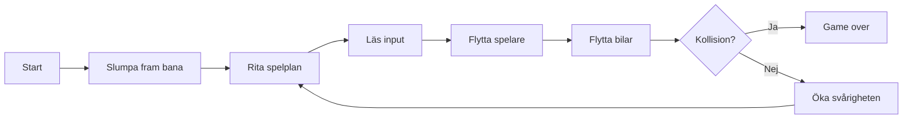

## Vår idé

Våran idé är att göra en textbaserad version av spelet crossy road som körs i terminalen, spelaren ska försöka ta sig så långt som möjligt i en bana bestående av säkra områden och bilar, blir man påkörd är spelet över.

Problemet vi vill lösa är hur man bygger ett spel där bilarna rör sig oberoende av spelaren och hur programmet upptäcker krockar mellan dem. Vi vill också lösa hur en bana kan genereras slumpmässigt men ändå alltid gå att klara, med ökande svårighetsgrad.

Spelet är intressant för andra eftersom det fungerar som kort och enkel underhållning, till exempel mellan föreläsningar eller på bussen, som dessutom inte kräver någon inloggning. Problemet vi vill lösa är framför allt tekniskt och många av problemen är vanliga i andra spel, vilket gör dem användbara även utanför detta projekt.

## Systemets delar

Spelet nedbrutet i mindre delar:

- spelplan: alla rader, och vad som finns på dem
- hinder: bilar som rör på sig som spelaren inte får röra
- inmatning: känner av vilken input spelaren ger
- kollisionskontroll: kontrollerar så inte spelaren står på samma plats som en bil
- randomfunktion: funktion som på något sätt genererar en slumpmässig bana
- svårighetsändring: funktion som på något sätt ökar svårighet ju längre spelaren kommer

Ett mermaid-diagram över hur spelet kan fungera:

## Representation

Från M5 (A, B, C) känner ni till följande enkla datatyper i Python:

- None
- Tal (av olika slag)
- Booleans (True/False)

Ni känner även till följande sammansatta datatyper i Python:

- Strängar
- Listor
- Tupler
- Dictionaries 

Beskriv vilka olika "saker" som finns i ert system och hur ni planerar att representera dessa i Python.

## Komplexitet och förenkling

Beskriv kortfattat hur systemet kan förenklas och hur komplexitet kan läggas till steg för steg.

Var inte rädda för att förenkla kraftigt. Ni kan även ge förslag på kreativa utökningar som ni skulle vilja lägga till om ni får tid över. 

enkel version kan ha stillastående bilar och konstant svårighetsgrad med en bana som upprepas i ett mönster.
ökad komplexitet kan lägga till rörliga bilar, slumpmässigt genererad bana med ökad svårighetsgrad, bilar med olika hastighet, poängräknare, olika svårighetsgrad

## Personliga utvecklingsmål

Beskriv hur ni planerar att ta hänsyn till era personliga utvecklingsmål under projektet. 

genom att bygga ett applikation med random funktion från grunden (från idé till färdig produkt) tar vi hänsyn till bådas utvecklingsmål 
